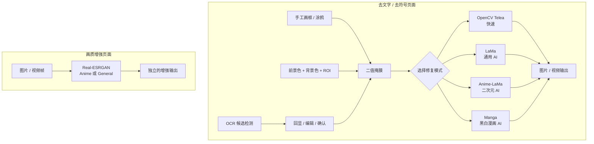

# 图片 / 视频文字、符号去除与画质增强

这是一个本地运行的桌面工具，重点服务于二次元图片、动画硬字幕、漫画文字和碍眼符号的移除。它包含 OpenCV 快速模式，基于掩膜的 LaMa、Anime-LaMa、Manga AI 修复模式，以及独立的 Real-ESRGAN 画质增强功能。

## 功能概览



## 修复区域与最终掩膜流程

内容修复页面采用“编辑、确认、执行”的工作流：

1. 点击“打开”，选择图片或视频。
2. 在“修复区域编辑方式”中选择当前要编辑的方式：手工矩形、手工涂鸦或颜色筛选。它不是三选一的最终来源；三种方式可分别确认后共同组成修复区域。
3. 在手工矩形或颜色筛选中拖出 ROI；颜色筛选再设置待去除的前景色、背景参考色、容差和描边扩张。手工涂鸦则直接在预览上绘制笔迹。
4. 点击该方式对应的确认按钮。程序只更新当前方式的贡献，并将全部已确认方式冻结为一个可序列化的组合 `MaskPlan`；红色半透明区域才是最终会被修复的像素。确认后临时绿色框/橙色草稿会收起，只保留红色冻结结果。颜色筛选还会显示冻结像素数；若筛不到任何像素，会直接提示检查颜色或容差。
5. 选择修复模式后点击全局“运行”。切换方式时会保留已确认的红色结果；清除当前方式只移除它自己的预选和已确认贡献，不影响其它方式。

视频可独立开启“动态 OCR 字幕定位”。开启后，处理阶段会在视频帧中重新检测字幕多边形，并直接将该帧多边形作为修复 mask；它不使用确认帧冻结的最终 mask。其检测频率可选“采样检测”或“逐帧检测”。关闭动态 OCR 后，视频才会在 A/B 处理区间内复用已经确认的手工矩形、涂鸦或颜色筛选 mask。**同一视频任务只能选择动态 OCR 或静态最终 mask，不能叠加。** 若希望先动态去字幕、再用涂鸦/颜色修理残留，或先移除固定台标、再跟踪移动字幕，请先完成第一次处理，再将输出视频作为一个新任务处理。

### 视频处理区间（A/B）

视频模式下，“视频处理区间”决定**处理哪些帧**，与矩形、涂鸦和颜色筛选所决定的“修复哪些像素”是两回事。未设置区间时处理整段视频；设置一个或多个区间后，只处理这些区间内的帧。

1. 在视频预览上右键，选择“将当前帧设为处理起点”，或按 `[`。
2. 移动到结束帧后再次右键，选择“将当前帧设为处理终点”，或按 `]`。起点和终点帧都包含在内；反向选择会自动按较早帧到较晚帧归正。
3. 可继续设置更多区间；右键菜单中的“清除所有处理区间”可恢复整段处理，在当前区间内按 `\` 或选择删除当前区间可移除其中一段。

这些右键操作只在视频模式下显示。设置起点但未设置终点时，区间尚未确认，运行仍不会把它当作有效范围。

## “运行 / 停止”按钮：队列能力边界

内容修复与画质增强页面中的“运行 / 停止”是**页面级任务队列控制按钮**，不用于单独启动当前选中的一行任务。每条任务仍独立保存状态、进度和执行配置；队列只决定它们的执行顺序。

| 操作 | 内容修复 | 画质增强 |
| --- | --- | --- |
| 点击“运行” | 将所有**已确认修复区域**的待处理任务按 FIFO 顺序加入队列 | 将所有待处理任务按 FIFO 顺序加入队列 |
| 同时执行数量 | 一次只执行一个任务，避免 AI 模型、显存、预览和输出文件相互竞争 | 一次只执行一个任务，避免超分模型、显存、预览和输出文件相互竞争 |
| 运行中新增任务 | 新文件先保持待处理；完成 OCR/手画并点击“确认修复区域”后，自动追加到当前队列 | 新文件创建后立即追加到当前队列，在当前任务结束后自动执行 |
| 点击“停止” | 终止当前修复任务；未开始任务保持待处理 | 请求当前增强任务在安全取消点结束；未开始任务保持待处理 |
| 再次点击“运行” | 从仍待处理且已确认区域的任务继续 | 从仍待处理的任务继续 |

任务的“处理中 / 已完成 / 失败 / 待处理”和各自百分比只属于对应任务行。切换选中行不会启动另一条任务，也不会改变正在运行任务的配置。运行期间删除或重置队列任务受到限制，避免改变已经调度的任务顺序。

## 最终掩膜：OCR 只是候选，不是笔画分割

PaddleOCR 的文字检测结果包含 `dt_polys`（文本行多边形）和 `dt_scores`；黄色/绿色选框只用于定位和编辑 OCR 候选范围。对于水平字幕，`dt_polys` 经常接近矩形——这是文本检测的正常输出，不是字符笔画的精确分割。最终送给 OpenCV、LaMa、Anime-LaMa 或 Manga 修复引擎的区域以半透明红色回显。

| 修复区域编辑方式 | 实际擦除内容 | 适用场景 |
| --- | --- | --- |
| 手工矩形 | 用户框出的整块区域 | 非文字对象，或明确希望整块重绘时。 |
| 手工涂鸦 | 用户逐笔涂抹的精确路径 | 需要严格控制 mask 面积的文字、描边、符号或 logo。 |
| 颜色筛选 | 在用户 ROI 内，颜色接近前景且比背景参考色更接近前景的像素；可只对已选字形做描边扩张 | 纯色/近似单色的台标、字幕、符号；复杂渐变需检查预览。 |

OCR 不属于通用对象分割能力，无法可靠区分人物、衣物、背景图案、装饰图标或所有艺术字。对于 OCR 漏检或需要更小 mask，可补充手工涂鸦；目标颜色稳定时，可在手工 ROI 内使用“前景色 + 背景色 + 容差 + 描边扩张”的颜色筛选。描边扩张发生在颜色判定**之后**，只扩大被选中的字形，适合补足抗锯齿、阴影或黑描边；它不会神奇地识别文字，过大仍会吞入邻近背景。已确认方式按并集组合，因此可先用矩形覆盖稳定区域，再以涂鸦或颜色筛选补足细节。所有方式都必须以红色最终 mask 预览为准。

> **实验性能力提示**：颜色筛选与“字幕像素精细定位”是基于颜色距离和形态学运算的局部启发式，不是语义分割。它们在压缩噪声、透明/发光字、渐变、多色字体、反色画面和复杂纹理上可能漏选或误选。请先在一张代表性图片或 5–10 秒视频片段上复核红/橙 mask 与输出，不要直接对唯一原始素材批量覆盖。

### 视频动态 OCR 字幕定位

动态 OCR 不是最终掩膜模式，而是视频专用的自动定位开关：

- **关闭（默认）**：按用户确认的手工最终 mask 修复选定 A/B 区间；
- **采样检测**：每隔指定帧数运行 OCR，相邻两次检测都存在字幕时，用两侧多边形的并集覆盖中间帧；适合位置缓慢变化的字幕。它只适用于普通动态 OCR；
- **逐帧检测**：每帧运行 OCR，最能跟随移动文字，也最慢。

动态 OCR 还提供“**字幕像素精细定位**”开关，默认关闭。它紧跟“动态 OCR 检测频率”，只有在“视频修复 + 动态 OCR 字幕定位 + 逐帧检测”时才显示；选择采样检测时该开关隐藏，并会自动关闭精细定位，避免其配置进入采样任务。开启后，内容修复页面底部会无标题地展开前景色、背景参考色、颜色容差和描边扩张按钮；每个按钮都提供悬浮说明，布局与颜色筛选的局部操作一致。OCR 多边形仍只承担字幕行的 ROI；程序会在 ROI 内按字幕前景色（默认白色）和背景参考色筛选更接近前景的像素，再按“字幕描边扩张”对字形小幅膨胀。前景、背景通过连续色相/饱和度面板和明暗滑块选择，不要求记忆颜色编码。该扩张是为了纳入白字常见的黑色描边和抗锯齿边缘，而不是重新扩大整块 OCR 框。容差可设为 `0–255`：越小越精细但越容易漏掉淡字/抗锯齿，越大越稳妥但可能带入背景。**程序会在每个实际处理帧重新根据该帧像素生成精细 mask，不复用上一帧字形。** 这是面对动态字幕和动态背景时唯一不会把旧字形拖到新画面的保守做法，但仍不能解决“字幕与背景颜色本身几乎相同”的信息缺失。若旧任务快照、导入任务或外部调用仍携带“采样检测 + 精细定位”，执行前会明确清除精细定位，不会静默带入采样路径。请以实际视频抽帧复核。

动态 OCR 开启时，任务页会收起“修复区域编辑”区域，仅保留全局“打开 / 运行”操作；运行前若任务仍保留静态组合 mask，程序会阻止执行并说明如何切换。这样不会发生“界面显示一个 mask、后台又叠加另一套 OCR 规则”的情况。

可在“高级设置”的“OCR 候选检测”“精确掩膜”和“视频采样与时序”分组中调整 PaddleOCR 像素阈值、检测框阈值、`unclip_ratio`、矩形扩边和动态 OCR 的采样间隔。动态 OCR 的字幕像素精细定位及其颜色、容差、描边扩张则位于内容修复主页面，并只在其前置条件满足时出现。`unclip_ratio` 可降至 1%，矩形扩边、颜色容差、颜色筛选描边扩张和动态描边扩张可设为 0，以便进行极小 mask 的精细试验。选择“手工涂鸦”后，笔刷半径仅在任务页显示；**每一笔会冻结当时的半径，之后调整粗细只影响下一笔**。选择“颜色筛选”后，前景色、背景参考色、容差和描边扩张也仅在任务页显示，并以色块与**橙色临时 mask**即时回显。矩形和涂鸦编辑时只显示绿色选框或橙色笔迹；每次确认只提交当前方式，红色区域始终表示全部已确认方式的组合。已确认计划及动态 OCR 参数都会随任务执行快照冻结，之后改设置不会反向改变已开始的任务。

## 修复模式选择

| 模式 | 适用内容 | 速度与限制 |
| --- | --- | --- |
| OpenCV Telea（快速） | 小字幕、纯色背景、连续纹理 | 最快，逐帧表现稳定；复杂线稿和遮挡物重建能力有限。 |
| LaMa（通用 AI） | 普通图片、自然背景、文字/水印/小物体 | 首次使用会下载模型；视频逐帧可能闪烁。 |
| Anime-LaMa（二次元 AI） | 彩色动漫插画、动画画面、无用文字和符号 | 二次元图片的首选；对“深色字 + 平坦气泡底色”会自动以邻域底色清理残笔；没有时序约束，长视频可能闪烁。 |
| Manga（黑白漫画 AI） | 黑白漫画、灰度线稿、气泡文字 | 输出为黑白线稿风格；不适合普通彩色动画画面。 |

AI 修复根据周围上下文生成补全内容，不保证还原被遮挡区域的真实原始像素。文字覆盖人物脸部、发丝、手部或密集线稿时，建议先在小范围图片上预览并人工检查结果。反过来，若文字落在颜色非常均匀的气泡/底板内，请优先让 mask 只覆盖字形及约 1–2 px 的抗锯齿边缘；Anime-LaMa 会在确认周围底色稳定且原字显著更暗时，用原图邻域底色清理模型遗留的浅灰笔画。大面积涂鸦、渐变或纹理背景不会触发这项收尾，以避免错误抹平细节。

### 结果有残字、发白或“明明选中了却修不好”时

红色区域只证明 **mask 的输入正确**，不保证生成式模型一定能补出正确内容。先按下表判断，而不是一味增大容差或扩大框：

| 现象 | 常见原因 | 推荐处理 |
| --- | --- | --- |
| 白色气泡内仍有灰色/黑色残笔 | 字形抗锯齿未被 mask 覆盖，或 AI 在稀疏笔画孔洞中重画出纹理 | 使用颜色筛选，描边扩张先设 1 px、必要时 2 px；ROI 与气泡边框留 2–3 px；重新运行 Anime-LaMa，或比较 OpenCV Telea。平坦底色会自动触发保守的邻域底色收尾。 |
| 画面被修得很假、线条断裂 | mask 包含了气泡边框、人物、发丝或大块真实背景；模型被迫重建过多内容 | 缩小 mask；文本压在复杂结构上时比较 Anime-LaMa 与 LaMa。不要把“红色越大越好”当作目标。 |
| 彩色区域用 Manga 后发白/发灰 | Manga 路径先转灰度，mask 内不会保留原图色相与饱和度 | 彩色动漫、插画和照片不要选 Manga；仅黑白/灰度漫画、线稿或最终就要黑白的输出使用它。 |
| 视频字幕位置、颜色或背景持续变化 | 静态 mask 被复用，或采样定位无法描述逐帧字形变化 | 使用动态 OCR；只有在“逐帧检测”下才开启字幕像素精细定位。先测试 5–10 秒代表片段。 |
| 细小纯色文字反而被 AI 修坏 | 这类背景不需要语义生成，AI 的自由度成为风险 | 先比较 OpenCV Telea；它对小区域、纯色底和连续纹理通常更稳定。 |

推荐的工作顺序是：先在副本或短视频片段上确认红/橙 mask，再从 **OpenCV Telea → Anime-LaMa/LaMa** 做小范围比较；只有文字确实覆盖复杂结构时才让 AI 承担大面积生成。Manga 不是彩色 Anime-LaMa 的替代品。更完整的模型输入输出、掩膜坐标、视频处理和参数细节见 [修复与增强技术参考](docs/REPAIR_AND_ENHANCEMENT_TECHNICAL_REFERENCE.md)。

## 画质增强功能

导航栏中的“画质增强”功能：

- `Real-ESRGAN Anime`：二次元插画/动画优先；
- `Real-ESRGAN General`：普通照片、通用图像优先；
- 提供 1×、1.5×、2×、3×、4× 输出倍率，默认 2×；
- 图片输出为 `原文件_enhanced_x倍率.png`，绝不覆盖原图；
- 视频按帧增强并尝试回封装原音频。4× 视频像素量约为原来的 16 倍，会显著增加显存、耗时与磁盘占用，并可能出现轻微闪烁。
- 支持一次添加多个图片或视频任务；任务按队列顺序执行，并显示名称、进度、状态与日志。处理期间显示输入/当前输出对比；任务完成后显示处理前/处理后的并排对比预览。
- “运行 / 停止”控制整个增强队列，而不是当前选中任务；运行中可继续点击“打开”追加任务。停止后，未开始任务仍为待处理，可再次运行。
- 增强页可切换“图片任务 / 视频任务”：已完成的图片始终以等大画面并排比较输入与输出；视频可通过帧滑块查看对应的输入/输出帧对比。

超分辨率会生成推测性的高频细节，不能视为对原始高分辨率信息的无损恢复。

## 图片格式转换与 ICO 制作

导航栏中的“图片转换”用于本地文件格式处理，不会调用 OCR、修复模型或超分模型：

- 支持 PNG、JPEG、WebP、BMP、TIFF 与 ICO 之间的常用图片转换；
- JPEG 和 BMP 不支持透明通道，转换时会以白色填充透明区域；
- ICO 输出可在一个文件中同时写入 16、32、48、64、128、256 像素等多个尺寸，Windows 会自动选择合适版本；
- 转换结果需要由用户选择保存位置，不会覆盖源文件。

## 安装与模型下载

### Windows（CPython 3.12）依赖安装

```powershell
python -m venv .venv
.\.venv\Scripts\Activate.ps1
python -m pip install --upgrade pip

# CPU 版：可使用 OpenCV 和全部 AI 修复/增强模式，但模型在 CPU 上推理。
.\scripts\install-runtime.ps1 -TorchBackend cpu -Python .\.venv\Scripts\python.exe
```

上述脚本会使用 `requirements/base.lock`、所选 `paddle-*.lock` 与 `torch-*.lock`，并启用哈希校验。锁文件当前针对 **Windows x86_64 + CPython 3.12** 生成；其他平台应重新解析对应的锁文件，不能拿 Windows 的二进制锁直接套用。

### PaddleOCR：CPU / GPU 与回退

PaddleOCR 的文字检测使用 PaddlePaddle，和修复模型使用的 PyTorch 是两套独立运行时。安装脚本提供两种 Paddle profile：

```powershell
# 最稳妥的 CPU OCR。
.\scripts\install-runtime.ps1 -TorchBackend cpu -PaddleBackend cpu -Python .\.venv\Scripts\python.exe

# NVIDIA GPU OCR（Paddle CUDA 11.8 wheel）；Torch 可独立选择 cu126。
.\scripts\install-runtime.ps1 -TorchBackend cu126 -PaddleBackend cu118 -Python .\.venv\Scripts\python.exe
```

CPU 与 GPU Paddle wheel 不能共存，脚本切换时会先移除旧 profile；GPU wheel 安装失败时，脚本会自动安装锁定的 CPU profile。GPU profile 运行时会先完整创建 `gpu:0` 检测器；只要 CUDA runtime、驱动、显存或模型初始化任一环节失败，就记录原因并重新创建 CPU 检测器。因此没有 NVIDIA GPU 或 GPU 环境不完整时，OCR 不会因“加速失败”而不可用。PaddleOCR 官方也将未指定设备的默认策略定义为“优先 GPU，否则 CPU”；这里显式重建 CPU 实例，是为了把失败路径变成可见、可测试的行为。[PaddleOCR Text Detection device 参数说明](https://paddlepaddle.github.io/PaddleOCR/v3.1.0/en/version3.x/module_usage/text_detection.html)

若它在你的平台上无法由锁文件正常安装，请先按 [PaddlePaddle 官方说明](https://www.paddlepaddle.org.cn/documentation/docs/install/pip/windows-pip_en.html) 安装与系统、Python 和 NVIDIA 驱动相符的版本，再重新生成对应平台的 lock。不要同时手动安装 `paddlepaddle` 和 `paddlepaddle-gpu`。

### PyTorch 与 CUDA

OpenCV 模式不依赖 PyTorch。LaMa、Anime-LaMa、Manga 和 Real-ESRGAN 则需要与设备匹配的 PyTorch profile。仓库提供已锁定的 CPU 与 CUDA 12.6 profile：

```powershell
# NVIDIA 驱动支持 CUDA 12.6 时使用；会安装锁定的 torch ... +cu126 wheel。
.\scripts\install-runtime.ps1 -TorchBackend cu126 -Python .\.venv\Scripts\python.exe

# 必须验证实际的 PyTorch CUDA 能力，而不是只确认机器装有 NVIDIA 显卡。
.\.venv\Scripts\python.exe -c "import torch; print(torch.__version__); print(torch.version.cuda); print(torch.cuda.is_available())"
```

只有最后一项输出 `True` 时，应用中的 `CUDA` 选项才可用；否则请选择 `CPU` 或 `自动`。`自动` 会尝试 CUDA 后回退 CPU，显式选择 `CUDA` 则会在环境不满足时给出错误。若驱动不支持 CUDA 12.6，或使用其他系统/架构，请按 [PyTorch 官方安装页](https://pytorch.org/get-started/locally/) 选择匹配的 wheel，并新建/更新对应 profile，而不是修改现有 `cu126` 锁文件。

`pip install -r requirements.txt` 只安装无 PyTorch 的基础依赖，适合 OpenCV 模式或需要自行管理 Torch 的场景；完整的 CPU/CUDA 安装请使用上面的脚本。

模型不会在启动 GUI 时下载。首次运行某个 AI 模式时，程序会优先使用已校验的模型缓存或兼容的内置权重；只有缺失时才下载到模型缓存目录，并在加载前校验 MD5。缓存目录可在“高级设置 → AI 模型与缓存”中改到有足够空间的磁盘。下载失败后重新运行即可安全重试；不完整文件不会被当作模型使用。

## 启动图形界面

```powershell
python gui.py
```

视频修复会重新编码为 H.264/yuv420p MP4，并尝试复制原音频。若源音频无法直接回封装，输出会退回为无音频视频；图片与视频输出都不会覆盖输入文件。

## 命令行

最小命令仍保持 OpenCV + 自动 OCR：

```powershell
python backend/main.py -i .\input.mp4
```

用 Anime-LaMa 直接移除指定区域（区域顺序为 `XMIN XMAX YMIN YMAX`）：

```powershell
python backend/main.py `
  -i .\input.png `
  -o .\output.png `
  --mode anime_lama --device cuda --no-ocr `
  --manual-area 120 560 620 710
```

`-c / --subtitle-area-coords` 仍可限制自动 OCR 的候选区域，其顺序为 `YMIN YMAX XMIN XMAX`；`-m / --manual-area` 则会直接产生修复掩膜，可重复指定。完整参数：

```powershell
python backend/main.py --help
```

## 开发与验证

不下载任何 AI 权重的回归测试：

```powershell
.\.venv\Scripts\python.exe -m unittest discover -s test -p "test_*.py" -v
```

静态语法检查：

```powershell
.\.venv\Scripts\python.exe -m compileall -q backend ui gui.py
```

可选 AI 集成测试需要本地已具备对应模型权重；默认测试不会联网或下载模型。

## 第三方许可与模型来源

CleanCanvas Studio 是基于 [YaoFANGUK/video-subtitle-remover](https://github.com/YaoFANGUK/video-subtitle-remover) 独立维护的衍生项目，并依据 Apache License 2.0 发布。它不是上游项目的官方版本，也不代表获得上游作者背书。项目参考 IOPaint 的 Apache-2.0 实现完成部分模型包装与输入掩膜处理，但未整体嵌入其 Web 应用、Diffusers、Gradio 或 ControlNet。

源码或二进制发行物应一并提供 [LICENSE](LICENSE)、[NOTICE](NOTICE)、[MODIFICATIONS.md](MODIFICATIONS.md)、[THIRD_PARTY_NOTICES.md](THIRD_PARTY_NOTICES.md) 与适用的 [第三方许可证文本](THIRD_PARTY_LICENSES)。Real-ESRGAN、BasicSR、FFmpeg、OpenCV、PaddleOCR/PaddlePaddle、PyTorch 及模型权重存在独立许可边界；发布包含模型、二进制或素材的安装包前，必须基于实际打包版本重新核验并补齐其许可证与 NOTICE。

参与贡献、报告问题与安全漏洞的方式分别见 [CONTRIBUTING.md](CONTRIBUTING.md) 和 [SECURITY.md](SECURITY.md)。
