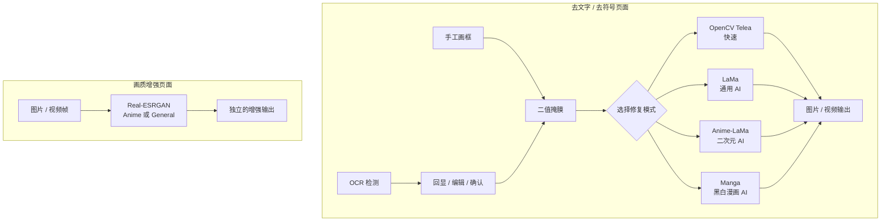

# 图片 / 视频文字、符号去除与画质增强

这是一个本地运行的桌面工具，重点服务于二次元图片、动画硬字幕、漫画文字和碍眼符号的移除。它包含 OpenCV 快速模式，基于掩膜的 LaMa、Anime-LaMa、Manga AI 修复模式，以及独立的 Real-ESRGAN 画质增强页面。

## 功能概览



## OCR 确认流程

内容修复页面采用“检测、编辑、确认、执行”的工作流：

1. 点击“打开”，选择图片或视频。
2. 对当前预览帧点击“检测当前帧 OCR”，候选文字框会回显在画面上。
3. 检查每一个框：可拖动、缩放，按 `Delete` 删除不需要的框，也可直接在预览中画新的矩形框。
4. 点击“确认修复区域”。当前选区会冻结为实际修复掩膜；未被 OCR 识别的装饰文字、符号或 logo 可通过手画框补充。
5. 选择修复模式后点击“运行”。编辑选区后需要重新确认，确保执行结果与当前选区一致。

视频处理取决于所选的掩膜更新策略：使用“确认帧静态掩膜”时，只需在有代表性的当前帧确认一次，确认后的掩膜会在 A/B 处理区间内复用；使用“采样 OCR 多边形”或“逐帧 OCR 多边形”时，程序会分别按采样帧或每一帧重新检测多边形。对于位置频繁移动的字幕，应优先使用后两种策略，或缩短 A/B 处理区间并分段处理。

## 精确掩膜：候选框不等于擦除区域

PaddleOCR 的文字检测结果本身包含 `dt_polys`（多边形轮廓）和 `dt_scores`；黄色选框只用于限制 OCR 候选范围，**不会在“OCR 多边形”模式中直接整块擦除**。最终送给当前选择的 OpenCV、LaMa、Anime-LaMa 或 Manga 修复引擎的区域以半透明红色回显。

| 最终掩膜模式 | 实际擦除内容 | 适用场景 |
| --- | --- | --- |
| OCR 多边形 | PaddleOCR 返回的文本轮廓及少量边缘扩张 | 普通字幕、印刷文字、规则艺术字与二次元文字。 |
| OCR 多边形 + 轮廓细化 | 多边形内与局部背景色差明显的连通区域 | 高对比文字、描边文字；建议检查红色预览。 |
| OCR 多边形 + 手工矩形 | 有 OCR 命中的框使用多边形；未命中框视为整块手工移除 | 同时含文字和不规则符号/logo。 |
| 手工矩形 | 用户框出的整块区域 | 非文字对象、OCR 无法检测的符号，或你明确希望整块重绘时。 |

OCR 不属于通用对象分割能力，无法可靠区分人物、衣物、背景图案、装饰图标或所有艺术字。对于 OCR 漏检的目标，可使用手工矩形或混合模式补充。轮廓细化基于 OpenCV 的局部颜色分割；在纹理背景或文字与背景颜色接近时，建议改用“OCR 多边形”模式并检查掩膜预览。

视频另有三档掩膜更新策略：

- **确认帧静态掩膜（默认）**：只 OCR 一次，复用确认的多边形，最快，适合固定字幕位置；
- **采样 OCR 多边形**：每隔指定帧数检测，介于速度和移动适应性之间；
- **逐帧 OCR 多边形**：每帧检测，适用于短片段或频繁移动的文字，但处理时间较长。

可在“高级设置”的“OCR 候选检测”“精确掩膜”和“视频采样与时序”分组中调整 PaddleOCR 像素阈值、检测框阈值、`unclip_ratio`、最终掩膜扩张、轮廓细化色差/最小连通域与视频采样间隔。改变这些参数后必须重新确认掩膜，避免用旧预览执行新参数。

## 修复模式选择

| 模式 | 适用内容 | 速度与限制 |
| --- | --- | --- |
| OpenCV Telea（快速） | 小字幕、纯色背景、连续纹理 | 最快，逐帧表现稳定；复杂线稿和遮挡物重建能力有限。 |
| LaMa（通用 AI） | 普通图片、自然背景、文字/水印/小物体 | 首次使用会下载模型；视频逐帧可能闪烁。 |
| Anime-LaMa（二次元 AI） | 彩色动漫插画、动画画面、无用文字和符号 | 二次元图片的首选；没有时序约束，长视频可能闪烁。 |
| Manga（黑白漫画 AI） | 黑白漫画、灰度线稿、气泡文字 | 输出为黑白线稿风格；不适合普通彩色动画画面。 |

AI 修复根据周围上下文生成补全内容，不保证还原被遮挡区域的真实原始像素。文字覆盖人物脸部、发丝、手部或密集线稿时，建议先在小范围图片上预览并人工检查结果。

## 画质增强功能

导航栏中的“画质增强”功能：

- `Real-ESRGAN Anime`：二次元插画/动画优先；
- `Real-ESRGAN General`：普通照片、通用图像优先；
- 提供 1×、1.5×、2×、3×、4× 输出倍率，默认 2×；
- 图片输出为 `原文件_enhanced_x倍率.png`，绝不覆盖原图；
- 视频按帧增强并尝试回封装原音频。4× 视频像素量约为原来的 16 倍，会显著增加显存、耗时与磁盘占用，并可能出现轻微闪烁。
- 支持一次添加多个图片或视频任务；任务按队列顺序执行，并显示名称、进度、状态与日志。处理期间显示输入/当前输出对比；任务完成后显示处理前/处理后的并排对比预览。
- 增强页可切换“图片任务 / 视频任务”：已完成的图片始终以等大画面并排比较输入与输出；视频可通过帧滑块查看对应的输入/输出帧对比。

超分辨率会生成推测性的高频细节，不能视为对原始高分辨率信息的无损恢复。

## 图片格式转换与 ICO 制作

导航栏中的“图片转换”用于本地文件格式处理，不会调用 OCR、修复模型或超分模型：

- 支持 PNG、JPEG、WebP、BMP、TIFF 与 ICO 之间的常用图片转换；
- JPEG 和 BMP 不支持透明通道，转换时会以白色填充透明区域；
- ICO 输出可在一个文件中同时写入 16、32、48、64、128、256 像素等多个尺寸，Windows 会自动选择合适版本；
- 转换结果需要由用户选择保存位置，不会覆盖源文件。

## 安装与模型下载

### Windows（CPython 3.12）依赖安装

```powershell
python -m venv .venv
.\.venv\Scripts\Activate.ps1
python -m pip install --upgrade pip

# CPU 版：可使用 OpenCV 和全部 AI 修复/增强模式，但模型在 CPU 上推理。
.\scripts\install-runtime.ps1 -TorchBackend cpu -Python .\.venv\Scripts\python.exe
```

上述脚本会使用 `requirements/base.lock` 和 `requirements/torch-cpu.lock`，并启用哈希校验。锁文件当前针对 **Windows x86_64 + CPython 3.12** 生成；其他平台应重新解析对应的锁文件，不能拿 Windows 的二进制锁直接套用。

项目需要 PaddlePaddle/PaddleOCR 用于文字检测。若它在你的平台上无法由锁文件正常安装，请先按 [PaddlePaddle 官方说明](https://www.paddlepaddle.org.cn/install/quick) 安装与系统相符的版本，再重新生成对应平台的锁文件。

### PyTorch 与 CUDA

OpenCV 模式不依赖 PyTorch。LaMa、Anime-LaMa、Manga 和 Real-ESRGAN 则需要与设备匹配的 PyTorch profile。仓库提供已锁定的 CPU 与 CUDA 12.6 profile：

```powershell
# NVIDIA 驱动支持 CUDA 12.6 时使用；会安装锁定的 torch ... +cu126 wheel。
.\scripts\install-runtime.ps1 -TorchBackend cu126 -Python .\.venv\Scripts\python.exe

# 必须验证实际的 PyTorch CUDA 能力，而不是只确认机器装有 NVIDIA 显卡。
.\.venv\Scripts\python.exe -c "import torch; print(torch.__version__); print(torch.version.cuda); print(torch.cuda.is_available())"
```

只有最后一项输出 `True` 时，应用中的 `CUDA` 选项才可用；否则请选择 `CPU` 或 `自动`。`自动` 会尝试 CUDA 后回退 CPU，显式选择 `CUDA` 则会在环境不满足时给出错误。若驱动不支持 CUDA 12.6，或使用其他系统/架构，请按 [PyTorch 官方安装页](https://pytorch.org/get-started/locally/) 选择匹配的 wheel，并新建/更新对应 profile，而不是修改现有 `cu126` 锁文件。

`pip install -r requirements.txt` 只安装无 PyTorch 的基础依赖，适合 OpenCV 模式或需要自行管理 Torch 的场景；完整的 CPU/CUDA 安装请使用上面的脚本。

模型不会在启动 GUI 时下载。首次运行某个 AI 模式时，程序会优先使用已校验的模型缓存或兼容的内置权重；只有缺失时才下载到模型缓存目录，并在加载前校验 MD5。缓存目录可在“高级设置 → AI 模型与缓存”中改到有足够空间的磁盘。下载失败后重新运行即可安全重试；不完整文件不会被当作模型使用。

## 启动图形界面

```powershell
python gui.py
```

视频修复会重新编码为 H.264/yuv420p MP4，并尝试复制原音频。若源音频无法直接回封装，输出会退回为无音频视频；图片与视频输出都不会覆盖输入文件。

## 命令行

最小命令仍保持 OpenCV + 自动 OCR：

```powershell
python backend/main.py -i .\input.mp4
```

用 Anime-LaMa 直接移除指定区域（区域顺序为 `XMIN XMAX YMIN YMAX`）：

```powershell
python backend/main.py `
  -i .\input.png `
  -o .\output.png `
  --mode anime_lama --device cuda --no-ocr `
  --manual-area 120 560 620 710
```

`-c / --subtitle-area-coords` 仍可限制自动 OCR 的候选区域，其顺序为 `YMIN YMAX XMIN XMAX`；`-m / --manual-area` 则会直接产生修复掩膜，可重复指定。完整参数：

```powershell
python backend/main.py --help
```

## 开发与验证

不下载任何 AI 权重的回归测试：

```powershell
.\.venv\Scripts\python.exe -m unittest discover -s test -p "test_*.py" -v
```

静态语法检查：

```powershell
.\.venv\Scripts\python.exe -m compileall -q backend ui gui.py
```

可选 AI 集成测试需要本地已具备对应模型权重；默认测试不会联网或下载模型。

## 第三方许可与模型来源

CleanCanvas Studio 是基于 [YaoFANGUK/video-subtitle-remover](https://github.com/YaoFANGUK/video-subtitle-remover) 独立维护的衍生项目，并依据 Apache License 2.0 发布。它不是上游项目的官方版本，也不代表获得上游作者背书。项目参考 IOPaint 的 Apache-2.0 实现完成部分模型包装与输入掩膜处理，但未整体嵌入其 Web 应用、Diffusers、Gradio 或 ControlNet。

源码或二进制发行物应一并提供 [LICENSE](LICENSE)、[NOTICE](NOTICE)、[MODIFICATIONS.md](MODIFICATIONS.md)、[THIRD_PARTY_NOTICES.md](THIRD_PARTY_NOTICES.md) 与适用的 [第三方许可证文本](THIRD_PARTY_LICENSES)。Real-ESRGAN、BasicSR、FFmpeg、OpenCV、PaddleOCR/PaddlePaddle、PyTorch 及模型权重存在独立许可边界；发布包含模型、二进制或素材的安装包前，必须基于实际打包版本重新核验并补齐其许可证与 NOTICE。

参与贡献、报告问题与安全漏洞的方式分别见 [CONTRIBUTING.md](CONTRIBUTING.md) 和 [SECURITY.md](SECURITY.md)。

## 延伸文档

- [图像与视频升级设计](docs/AI_IMAGE_VIDEO_UPGRADE_TASKS.md)
- [精确多边形掩膜设计](docs/PRECISE_MASK_UPGRADE_TASKS.md)
- [OCR、图像修复与超分辨率模型说明](docs/AI_MODELS_EXPLANATION_AND_STUDY_GUIDE.md)
- [系统架构与技术说明](docs/PROJECT_STUDY_AND_GRADUATE_INTERVIEW_GUIDE.md)
- [问题与解决方案记录](docs/ISSUES_AND_SOLUTIONS.md)
