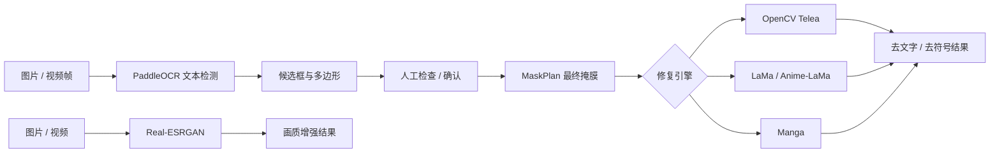

# CleanCanvas Studio：AI 模型说明与学习指南

> 本文以当前仓库实际代码为准，说明项目调用了哪些视觉模型、每个模型在流水线中的作用、输入输出与局限，以及建议的学习顺序。本项目的核心是 OCR、图像修复和超分辨率等计算机视觉模型。

## 1. 先建立全局认识

CleanCanvas Studio 的目标不是“识别图片内容后重新画一张图”，而是完成一条可控的本地视觉处理链：

其中，PaddleOCR 负责“在哪里”，掩膜决定“修哪里”，LaMa/Anime-LaMa/Manga 或 OpenCV 决定“怎么补”，Real-ESRGAN 则负责“如何放大和增强细节”。模型不会替代用户对最终掩膜和结果的判断。

## 2. 当前模型与算法总表

| 名称 | 类别 | 当前作用 | 是否需要 PyTorch | 典型输入 / 输出 |
| --- | --- | --- | --- | --- |
| PP-OCRv5 Server TextDetection | 文本检测模型 | 定位文字多边形，生成 OCR 候选 | 否，使用 PaddlePaddle / PaddleOCR | 图像帧 → `dt_polys` 多边形与 `dt_scores` 分数 |
| OpenCV Telea | 传统图像修复算法 | 快速修复小区域 | 否 | BGR 图像 + 二值 mask → 修复图像 |
| LaMa | 通用图像修复模型 | 补全普通图像、照片或复杂背景中的遮挡区域 | 是 | RGB 图像 + mask → 修复图像 |
| Anime-LaMa | 二次元图像修复模型 | 补全动漫插画、动画帧中的文字或符号区域 | 是 | RGB 图像 + mask → 修复图像 |
| Manga Inpaintor + Erika | 漫画修复模型组 | 处理黑白漫画、线稿与气泡文字 | 是 | 灰度图 + mask → 漫画风格修复结果 |
| Real-ESRGAN Anime | 超分辨率模型 | 增强二次元插画与动画帧 | 是 | BGR 图像 → 放大后的 BGR 图像 |
| Real-ESRGAN General | 超分辨率模型 | 增强普通照片和通用图像 | 是 | BGR 图像 → 放大后的 BGR 图像 |

## 3. 文字检测：PP-OCRv5 Server TextDetection

### 它做什么

项目在 [backend/tools/subtitle_detect.py](../backend/tools/subtitle_detect.py) 中使用 PaddleOCR 的 `TextDetection`，当前配置模型为 `PP-OCRv5_server_det`。它只做**文字位置检测**，不做文字识别、翻译或语义理解。

模型输出的重点是：

- `dt_polys`：每段文字的多边形轮廓；
- `dt_scores`：对应检测结果的置信分数。

项目将这些顶点保留为 `OcrPolygon`，而不是退化成外接矩形。因此，倾斜文字或不规则排版不会天然变成一整块大矩形 mask。

### 它不做什么

PaddleOCR 不是任意对象分割模型，也不是字符笔画级的实例分割模型。`dt_polys` 对水平字幕通常接近整行四边形，内部仍可能含有笔画间空白、描边、阴影或背景。OCR 漏检，或需要严格压缩 mask 面积的目标，应使用“手工涂鸦”；目标与背景颜色稳定时，可先框定 ROI，再使用“前景色 + 背景色 + 容差 + 描边扩张”的颜色筛选。描边扩张只发生在已经选中的字形上，适合补足抗锯齿和描边，不是对象分割。不要把 OCR 或颜色距离当作万能抠图工具。

### 组合修复区域的可控来源

`MaskPlan` 不再把启发式局部色差称为“OCR 细化”。“修复区域编辑方式”只决定当前编辑哪一种来源，不是三选一的最终来源：

- **手工矩形**：明确整块重绘的区域；
- **手工涂鸦**：以相对源图坐标冻结用户逐笔涂抹的路径，是最直接的像素级控制；
- **颜色筛选**：只在用户画出的 ROI 内保留“接近前景色且比背景参考色更接近前景”的像素；可再仅扩张这些已选字形以补足描边；

每一种来源在用户确认后才加入红色半透明组合 mask；修复模型接收的是这些确认来源的二值并集。矩形与涂鸦编辑时分别保留绿色选框和橙色笔迹，颜色筛选为方便核对阈值而显示橙色临时 mask。OCR 候选不属于这些来源，它只生成可编辑的初始选框。

### 当前运行方式

- 检测模型目录：`backend/models/V5/ch_det`；
- `TextDetection` 先完整尝试 `gpu:0`，失败时重新创建 CPU 检测器；它不跟随 PyTorch 的 AI 设备选项；
- OCR 阈值、检测框阈值与 `unclip_ratio` 可在高级设置调整；
- 视频可独立开启动态 OCR 字幕定位：采样检测按间隔重新检测并填补中间帧，逐帧检测每帧重新检测；关闭时使用已确认的组合 mask。“字幕像素精细定位”默认关闭，位于内容修复主页面，且仅在视频动态 OCR 已开启时显示。开启后会在 OCR ROI 内按前景/背景 LAB 距离提取字幕字形，并小幅扩张字形以包含常见黑色描边；由于字幕字形、位置和背景都会随视频帧变化，精细 mask 必须在每个实际处理帧从当前像素重新计算，绝不跨帧复用，因此该开关会固定为逐帧检测并禁用采样检测。它仍是实验性启发式：字幕颜色与画面内容接近、渐变/透明/发光字或压缩噪声重时，没有任何参数能可靠还原语义边界。动态 OCR 与静态组合 mask 在同一视频任务中仍互斥；需要两种方法时，必须以前一次输出作为下一次的新输入。

学习时建议先理解“检测”和“识别”的区别：本项目只需要检测多边形来制作掩膜，不需要知道文字具体写了什么。

## 4. 图像修复模型：LaMa 与 Anime-LaMa

### 共同任务：掩膜图像修复

LaMa 与 Anime-LaMa 都属于图像修复（inpainting）模型。输入是一张图像和一个二值 mask：mask 中的白色区域表示需要补全的位置，模型需要根据周围上下文生成合理内容。

当前实现位于 [backend/inpaint/engine.py](../backend/inpaint/engine.py)：

1. 将 BGR 图像转为 RGB；
2. 将图像与 mask 补齐到 8 的倍数；
3. 通过 TorchScript 模型推理；
4. 裁回原尺寸，并强制保留 mask 外的原始像素。

最后一步非常重要：它避免模型在未选中的区域产生不必要改动。

### LaMa：通用图像修复

- 权重文件：`big-lama.pt`；
- 适合照片、自然背景、纹理、一般水印或小物体遮挡；
- 首次运行时优先使用校验通过的缓存或兼容内置权重，缺失时才下载；
- 对视频按帧独立推理，没有时间一致性约束，因此可能闪烁。

对于“深色字形位于近乎纯色气泡/底板”的特殊情形，当前实现还会做一层保守收尾：逐个检查 mask 连通域的原始像素是否明显更暗，并检查其 mask 外 4 px 邻域在 Lab 色彩空间中是否高度一致。只有两项都成立，才用该邻域的真实中位色覆盖 mask 内残留笔画。这是为了处理 Anime-LaMa 偶尔在白色气泡中保留或重绘浅灰文字的情况，并不是泛化的后期涂抹；渐变、纹理、彩色物体以及包含大量背景的宽泛涂鸦 mask 会跳过，继续保留模型输出。

### Anime-LaMa：二次元修复

- 权重文件：`anime-manga-big-lama.pt`；
- 面向彩色动漫插画、动画帧、清晰线稿和二次元文字；
- 它更符合二次元画面的训练分布，但不意味着一定能恢复被文字遮挡的真实发丝、脸部或复杂图案；
- 长视频中的每帧仍独立修复，画面运动越复杂，闪烁风险越高。

### 正确理解“修复”

修复模型补全的是统计上合理的内容，不是读取被遮挡位置的真实历史像素。结果“看起来合理”不等于“真实还原”。对人物五官、手部、密集线稿等重要区域，应先用小范围图片测试并人工检查。

## 5. Manga：黑白漫画修复模型组

Manga 模式不是单一权重，而是配合运行：

- `manga_inpaintor.jit`：负责漫画区域补全；
- `erika.jit`：辅助提取线稿信息。

当前代码会先将输入转换为灰度图，结合线稿与 mask 推理，再将结果转换回三通道 BGR 以统一后续输出接口。它适合黑白漫画、灰度线稿、气泡文字和拟声字，不建议把它作为普通彩色照片或彩色动画画面的默认选项。

学习这一模式时，可以重点观察“颜色空间转换”和“任务先验”：模型并非通用得更强，而是通过针对黑白线稿的输入表示换取特定场景的表现。

## 6. 画质增强模型：Real-ESRGAN

画质增强位于独立页面，对应实现为 [backend/enhance/realesrgan.py](../backend/enhance/realesrgan.py)。它不负责去文字；应先决定是否修复文字，再决定是否增强画质。

### Anime 与 General

| 模型 | 权重文件 | 更适合的输入 |
| --- | --- | --- |
| Real-ESRGAN Anime | `RealESRGAN_x4plus_anime_6B.pth` | 二次元插画、动画帧、较清晰的动漫线条 |
| Real-ESRGAN General | `realesr-general-x4v3.pth` | 普通照片和一般通用图像 |

当前 Anime 实现采用 RRDBNet 结构，General 采用紧凑 SRVGG 网络。两者原生都会产生 4×结果；用户在界面选择 1×、1.5×、2×、3× 时，项目会先完成模型推理，再用 Lanczos 高质量缩放到目标尺寸。

### 为什么大图更慢

超分辨率推理主要受像素数量影响，而不是磁盘文件的 MB 数。宽高各增加两倍，总像素约增加四倍；4×输出的总像素约为输入的 16 倍。项目默认以 `512px` 分块、`10px` 重叠边缘处理大图，降低显存峰值，但不会改变总计算量。

### 视频增强

视频会逐帧增强、重新编码，并尝试回封装原音频。它会显著增加耗时、显存占用和输出体积，也可能出现轻微闪烁。任务完成后，界面会把输入和输出缩放到相同显示尺寸并排比较；这便于比较质量，但不表示两侧文件的真实分辨率相同。

## 7. OpenCV Telea：不是大模型，但很重要

`OpenCV Telea` 是传统图像修复算法，不使用神经网络、不下载权重，也不使用 AI 设备设置。它速度快、逐帧稳定，适合小字幕、纯色背景和连续纹理；但遇到人物、复杂线稿、渐变或大面积遮挡时，通常不如 AI 修复模型。

学习项目时不要把“传统算法”和“深度学习模型”混在一起：二者的输入都可以是图像和 mask，但补全机制、硬件依赖、速度和失败模式完全不同。

## 8. 设备与模型加载策略

### AI 设备

LaMa、Anime-LaMa、Manga 和 Real-ESRGAN 使用 PyTorch。选择“自动”时，项目会：

1. 完整尝试初始化 CUDA 模型；
2. CUDA 不可用、驱动/显存异常或模型初始化失败时，完整尝试 CPU；
3. 使用第一个可用设备；两者都失败时报告两个候选的错误原因。

显式选择 CUDA 或 CPU 时不会自动改用另一种设备。PaddleOCR 检测模型由 PaddlePaddle 独立运行，不跟随 PyTorch 的“AI 运算设备”选项：每次初始化会先尝试 `gpu:0`，失败后重新建立 CPU 检测器。安装时必须在 Paddle CPU 与 GPU profile 中二选一；GPU wheel 不可用、驱动/runtime 不匹配或显存不足时，运行时回退依然有效。

### 缓存与完整性

AI 权重由 `ModelStore` 统一管理。模型文件先下载到临时文件，MD5 校验通过后再原子替换到正式缓存位置，避免断网后把半个文件当作可用模型。默认缓存目录为 `backend/models/ai`，也可通过高级设置或环境变量 `VSR_MODEL_DIR` 改写。

## 9. 建议学习路径

### 第一步：图像与 mask 基础

学习 OpenCV 的 BGR/RGB、灰度图、二值 mask、形态学、插值和 `cv2.inpaint`。建议先用 OpenCV Telea 在一张纯色背景图片上观察 mask 变大或变小时的差异。

### 第二步：OCR 多边形与掩膜计划

阅读 [backend/tools/subtitle_detect.py](../backend/tools/subtitle_detect.py) 和 [backend/masking.py](../backend/masking.py)。重点理解：候选 ROI、`dt_polys`、`OcrPolygon`、`MaskPlan` 和最终红色掩膜不是同一个概念。

### 第三步：TorchScript 修复模型

阅读 [backend/inpaint/engine.py](../backend/inpaint/engine.py)。实践目标：比较 OpenCV、LaMa、Anime-LaMa 和 Manga 在同一个 mask 下的结果，并记录速度、显存和失败类型。

### 第四步：超分辨率与分块推理

阅读 [backend/enhance/realesrgan.py](../backend/enhance/realesrgan.py)。观察 Real-ESRGAN 的原生 4×输出、不同倍率的后处理、以及 `512px` 分块如何降低一次性推理的显存压力。

### 第五步：视频工程化问题

阅读 [backend/enhance/media_enhancer.py](../backend/enhance/media_enhancer.py) 与 [backend/main.py](../backend/main.py)。重点理解逐帧推理、预览节流、H.264 编码、音频回封装、帧间闪烁和任务取消。

## 10. 可用于答辩或学习汇报的一分钟总结

> CleanCanvas Studio 没有使用通用对话大语言模型，而是组合了多类本地视觉模型：PaddleOCR 用于文本多边形检测，LaMa 和 Anime-LaMa 用于通用与二次元图像修复，Manga 模型组用于黑白漫画线稿修复，Real-ESRGAN 用于动漫或通用图像超分辨率。用户从手工矩形、手工涂鸦、颜色筛选三种最终来源中选择一种并确认红色最终 mask，再把它交给对应修复引擎；视频也可独立开启动态 OCR，以采样或逐帧检测实时生成字幕 mask。模型输出是基于上下文的合理补全或细节推测，因此需要通过红色掩膜预览和处理前后对比进行人工复核。

## 11. 相关文档

- [README](../README.md)：使用、安装与命令行入口；
- [修复与增强技术参考](REPAIR_AND_ENHANCEMENT_TECHNICAL_REFERENCE.md)：模型、输入输出、全图 mask、预处理、后处理、视频链路与参数实现细节；
- [NAFNet 与 Restormer 全图复原接入设计](NAFNET_RESTORMER_INTEGRATION_DESIGN.md)：尚未实现的清晰复原模型接入方案、输入输出契约、代码结构、任务快照与测试计划；
- [项目学习与复试指南](PROJECT_STUDY_AND_GRADUATE_INTERVIEW_GUIDE.md)：更完整的项目架构、答辩与面试材料；
- [精确掩膜升级记录](PRECISE_MASK_UPGRADE_TASKS.md)：OCR 多边形、掩膜和视频策略的设计记录；
- [问题与解决方案](ISSUES_AND_SOLUTIONS.md)：已知问题、根因、验证证据与能力边界。
