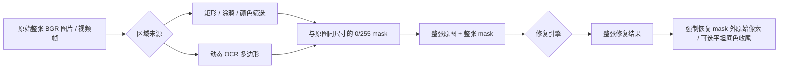

# 当前局部修复与全图增强：技术实现参考

本文描述当前代码实际执行的图像/视频处理链路，面向维护者、需要排障的高级用户和二次开发者。它不是模型宣传页：文中区分了“用户看到的预选框”“最终二值 mask”“模型真正收到的张量”，也明确列出会导致结果看似反常的边界条件。

适用版本以仓库中的 `backend/masking.py`、`backend/main.py`、`backend/inpaint/engine.py`、`backend/tools/subtitle_detect.py` 和 `backend/enhance/` 为准；界面配置以 `backend/config.py` 为准。

## 1. 一句话总览

内容修复不是“把一个局部小图裁下来交给模型”。正常图片与视频帧路径都是：



预选框的作用是限定矩形或颜色筛选的 **ROI**；它不会令 LaMa、Anime-LaMa、Manga 或 Telea 只接收那一块裁剪图。这样做的目的是让模型能看到目标周围、甚至更远处的结构与颜色，同时确保最终结果仅允许改变 mask 内部。

## 2. 当前使用的模型与算法

> **能力状态说明**：本章只记录仓库当前已经接入、可以由现有界面/后端实际调用的模型与算法。讨论过的 NAFNet、Restormer、DiffBIR、SUPIR、GFPGAN、CodeFormer、SeedVR 等模型目前**尚未接入本项目**，不应把它们写入用户手册、任务日志或界面能力说明，更不能误认为现有“画质增强”已经具备去模糊、去噪或生成式盲恢复。

| 功能 | 实现 / 权重 | 输入 | 输出 | 主要适用对象 | 关键限制 |
| --- | --- | --- | --- | --- | --- |
| OCR 候选检测 | PaddleOCR `PP-OCRv5_server_det` | 完整 BGR 图像/帧 | `dt_polys` 多边形、分数 | 定位文字行或字幕候选 | 是文本检测，不是字形级分割，也不识别任意对象 |
| 快速修复 | OpenCV `INPAINT_TELEA`，半径固定为 3 | 完整 BGR 图 + 二值 mask | 完整 BGR 图 | 小文字、近纯色底、连续背景 | 大面积遮挡、人物、复杂线稿容易失真 |
| 通用修复 | TorchScript `big-lama.pt` | 完整 RGB 图 + 二值 mask | 完整 BGR 图 | 照片、自然纹理、通用文字/水印 | 生成合理内容，不保证真实还原 |
| 二次元修复 | TorchScript `anime-manga-big-lama.pt` | 完整 RGB 图 + 二值 mask | 完整 BGR 图 | 彩色动漫、插画、动画帧 | 无时序约束；复杂线条可能重画错误 |
| 漫画修复 | `manga_inpaintor.jit` + `erika.jit` | 完整**灰度**图、线稿、mask | mask 内灰度 BGR，外部原色 | 黑白/灰度漫画、线稿 | 彩色 mask 内必然丢失色相/饱和度，不适合彩色画面 |
| 画质增强 | Real-ESRGAN Anime / General | 完整 BGR 图或视频帧 | 放大后的 BGR 图 | 二次元或通用图片/视频 | 推测高频细节，不能恢复真实丢失细节；视频可能闪烁 |

修复模式元信息集中在 [engine.py](../backend/inpaint/engine.py)，Real-ESRGAN 的模型与权重定义集中在 [realesrgan.py](../backend/enhance/realesrgan.py)，OCR 检测权重位置和模型名在 [model_config.py](../backend/tools/model_config.py)。

### 2.1 当前能力、模型与未来候选的边界

| 类别 | 当前状态 | 典型输入 | 典型输出 | 备注 |
| --- | --- | --- | --- | --- |
| 局部擦除与重绘 | 已接入：Telea、LaMa、Anime-LaMa、Manga | 整图/整帧 + 同尺寸二值 mask | 同尺寸修复图/帧 | 适合去文字、水印、符号及局部二次修复 |
| OCR 定位 | 已接入：PaddleOCR 文本检测 | 整图/整帧 | 文本多边形与分数 | 只定位候选区域，不等于字符笔画分割 |
| 整图放大与视觉增强 | 已接入：Real-ESRGAN Anime / General | 整图/整帧 | 放大后的整图/整帧 | 不知道哪个局部是错误补丁，不能替代局部二次修复 |
| 去模糊、去噪、去压缩伪影 | **未接入**；候选为 NAFNet / Restormer | 整图/整帧 | 通常同尺寸的复原图/帧 | 未来应归入“全图复原与增强”的清晰复原阶段 |
| 强生成式盲恢复 | **未接入**；候选为 DiffBIR / SUPIR | 整图/整帧，部分模型含提示/条件 | 视觉上更完整的图/帧 | 可能生成不存在的细节，应作为独立实验能力 |
| 人脸专用恢复 | **未接入**；候选为 GFPGAN / CodeFormer | 人脸检测、对齐后的局部 | 回贴到整图的人脸结果 | 可能改变身份特征，不适用于事实性复原 |
| 时序视频复原 | **未接入**；候选为 SeedVR 等 | 连续视频片段 | 连续视频片段 | 当前视频增强与修复均为逐帧处理，可能闪烁 |

### 2.2 关键实现入口与职责地图

| 文件 / 类型 | 关键职责 | 读取什么 | 产生什么 |
| --- | --- | --- | --- |
| [backend/masking.py](../backend/masking.py) | `MaskPlan`、矩形/涂鸦/颜色 mask、OCR 多边形 mask | 原图/当前帧、冻结计划、颜色参数 | 与输入同尺寸的 `uint8` 0/255 mask |
| [backend/inpaint/engine.py](../backend/inpaint/engine.py) | 修复引擎枚举、模型下载校验、LaMa/Anime-LaMa/Manga 推理、mask 外保护 | BGR 图、二值 mask、模型权重 | 修复后的 BGR 图 |
| [backend/inpaint/opencv_inpaint.py](../backend/inpaint/opencv_inpaint.py) | Telea 适配器 | BGR 图、mask | Telea 修复结果 |
| [backend/main.py](../backend/main.py) | 图片/视频修复编排、每帧 mask、引擎缓存、A/B 区间、预览与输出 | 任务快照、图片或视频帧 | 图片文件或逐帧编码的视频 |
| [backend/tools/subtitle_detect.py](../backend/tools/subtitle_detect.py) | PaddleOCR GPU 优先/CPU 回退、`dt_polys` 解析、采样/逐帧动态 OCR | 完整帧、OCR 配置、可选检测 ROI | `OcrPolygon` 列表、帧号到多边形映射 |
| [backend/enhance/realesrgan.py](../backend/enhance/realesrgan.py) | Real-ESRGAN 权重加载、设备回退、RGB 张量、tile 推理与缩放 | 完整 BGR 图、倍率 | 放大后的 BGR 图 |
| [backend/enhance/media_enhancer.py](../backend/enhance/media_enhancer.py) | 图片/视频增强任务、进度、预览节流、音频回封装 | 文件、增强任务快照 | PNG 或 MP4 输出 |
| [backend/tools/video_io.py](../backend/tools/video_io.py) | 视频帧预取与 FFmpeg 原始帧编码 | BGR 帧、FPS、尺寸 | H.264/yuv420p 视频流 |
| [backend/config.py](../backend/config.py) | 持久化默认配置、范围约束与兼容默认值 | 配置文件 | 供 UI/后端读取的配置项 |

## 3. 区域、mask 与坐标：最容易混淆的三层

### 3.1 预选框不是最终 mask

界面上的绿色框、橙色草稿和红色覆盖层含义不同：

| 视觉状态 | 数据含义 | 是否会执行 |
| --- | --- | --- |
| 绿色框 | 当前矩形/颜色筛选 ROI 草稿 | 否 |
| 橙色笔迹或橙色 mask | 当前涂鸦路径、或颜色筛选的实时计算结果 | 否 |
| 红色半透明区域 | 已确认并冻结的组合 `MaskPlan` 重建结果 | 是 |

静态修复可组合三个来源，最终按像素并集（OR）构建：

```text
final_mask = rectangle_mask OR brush_mask OR color_mask
```

这也是为什么“编辑方式”并非最终区域来源的三选一。确认矩形后，再确认涂鸦或颜色筛选，不会覆盖前一项。`MaskPlan` 会序列化到任务快照，运行子进程不会读取之后才被用户改变的 GUI 草稿或参数。

### 3.2 坐标和分辨率

矩形坐标保存为原始媒体像素的 `(xmin, xmax, ymin, ymax)`；边界会排序、裁剪到图像尺寸，并丢弃空矩形。涂鸦路径保存为 0–1 的相对坐标，每一笔还冻结当时的原图像素半径，因此预览缩放、后来调整笔刷半径都不会改变已确认的笔画。

颜色筛选的 ROI 使用全尺寸矩形 mask，筛选结果也保持为与源图同宽高的单通道 `uint8` mask。它不会在 ROI 中裁图推理。

### 3.3 颜色筛选与描边扩张

颜色筛选在 CIELAB 空间比较颜色，而不是直接比较 RGB：

```text
selected = inside_roi
           AND distance(pixel_lab, foreground_lab) <= tolerance
           AND distance(pixel_lab, foreground_lab) < distance(pixel_lab, background_lab)
```

之后才对 `selected` 作椭圆核膨胀，补入抗锯齿与描边。重要的细节是：**描边扩张扩大的是已选字形，不是整个 ROI**；并且不会裁回 ROI，以覆盖恰好贴着框边的描边。颜色容差范围为 0–255；颜色接近、渐变、透明、发光或多色字体没有可保证的阈值，宜改用涂鸦或更小的组合区域。

### 3.4 OCR 多边形与静态 mask 是两条路径

PaddleOCR 的 `dt_polys` 是文字行外轮廓。普通动态 OCR 将其填充为整块多边形 mask，必要时再按“最终掩膜扩边”膨胀。它不进入静态 `MaskPlan`，也不会自动变成字符笔画。

视频开启“字幕像素精细定位”时，才会把 OCR 多边形当作严格 ROI，再复用上面的 Lab 前景/背景判定，只留下更接近字幕色的像素，并对字形作独立的描边扩张。此功能要求逐帧检测；采样检测若携带旧的精细定位快照，运行时会主动关闭精细定位，避免把某一帧的字形误用于另一帧。

## 4. 图片修复的实际数据流

### 4.1 输入读取与 mask 构建

1. 图片由 OpenCV 读取为 `uint8 BGR`；Unicode 路径通过字节读取/解码路径兼容。
2. `MaskPlan.from_dict()` 从任务快照恢复已确认的矩形、涂鸦、颜色参数和扩边参数。
3. `build_mask(image_bgr, plan)` 在**整张图**上生成单通道 `uint8` 的 0/255 mask。
4. mask 全为 0 时直接返回原图，不加载修复模型。
5. 否则同一帧的“完整 BGR 图 + 完整 mask”传给选定引擎。

图片输出按目标扩展名通过 `cv2.imencode` 编码，默认/异常扩展名回退为 PNG；源文件不被覆盖，除非用户主动将输出路径指定为相同位置和名称。

### 4.2 OpenCV Telea

`cv2.inpaint(frame, mask, 3, cv2.INPAINT_TELEA)` 对完整帧执行。它没有设备、模型权重、随机种子或 AI 下载需求。它适合需要“从邻近像素延展”的任务，尤其是小字位于纯色气泡、字幕条或连续纹理时；当 mask 覆盖结构性内容（脸、手、透视线、复杂头发）时，没有语义理解能力。

### 4.3 LaMa 与 Anime-LaMa

两者共享 `TorchScriptLaMaEngine`，区别仅为权重。处理步骤：

1. 完整 BGR 图前三通道转为 RGB；mask 以 `mask > 0` 二值化。
2. 图像按边缘镜像方式补到 8 的倍数；mask 按常数 0 补到相同尺寸。
3. 图像转为 `float32` 的 `[1, 3, H, W]`，范围 0–1；mask 转为 `[1, 1, H, W]`，范围 0/1。
4. 在 CUDA 或 CPU 上调用 TorchScript 模型；`auto` 会真的尝试 CUDA 初始化，失败后重建 CPU 模型。
5. 截回原尺寸、转回 BGR `uint8`。
6. **强制把 mask 外像素恢复为原图。** 这保证网络即使轻微改动整帧，最终输出也只改变 mask 内。

LaMa/Anime-LaMa 在单张图内推理是全图上下文，不会按用户框裁成局部输入；这可帮助它理解气泡、人物和背景的关系，但也解释了为什么模型会“猜错”mask 内应补的内容。

### 4.4 平坦底色文字收尾

Anime-LaMa 或 LaMa 对“浅色气泡 + 稀疏深色字形”有时会在 mask 内留浅灰残笔。模型输出后，项目会逐个检查 mask 连通域：

- 原图中该连通域的亮度应明显低于其周围；
- 连通域外约 4 px 的采样环应在 Lab 空间足够一致；
- 满足时才取采样环的原图中位 BGR 色覆盖该连通域。

因此它是确定性的局部底色恢复，不是对输出全图“涂白”。渐变、纹理、彩色物体和包含大量背景的宽泛涂鸦会被跳过；mask 外仍会在第 6 步被恢复为原像素。实现见 [engine.py](../backend/inpaint/engine.py)。

### 4.5 Manga 为什么会让彩色区域发白

Manga 路径在推理前执行 `BGR → GRAY`，以灰度和 Erika 线稿作为模型输入；模型结果再执行 `GRAY → BGR`。之后只有 mask 外像素被原始彩色图恢复。因此 mask 内的结果三通道相同，原始色相、饱和度和细微暖/冷灰都不可恢复。这是数据通路的必然结果，不是简单调大容差或换 GPU 能解决的问题。

## 5. 视频修复的实际数据流

视频以 OpenCV 解码、后台 `FramePrefetcher` 预取，修复后把 BGR 原始帧通过 FFmpeg 管道编码为 H.264：`libx264`、`yuv420p`、CRF 18、`fast` 预设。完成后尝试流复制原音频；若源无音频或回封装失败，仍保留已成功编码的无音频画面结果。

### 5.1 静态组合 mask

关闭动态 OCR 时，确认帧的 `MaskPlan` 对所有位于 A/B 区间的帧重新构建：矩形和涂鸦的坐标固定；颜色筛选则对**当前视频帧**的像素重新计算。因此颜色筛选在动态背景下可能随帧改变命中范围，即便 ROI 本身固定。区间外帧原样写出。

### 5.2 动态 OCR

动态 OCR 与静态 `MaskPlan` 互斥：同一任务同时携带二者会报错，避免“界面看见一套区域、后台叠加另一套规则”。

1. 先扫描视频并在指定 A/B 区间内检测 OCR 多边形。
2. **逐帧检测**：每个处理帧独立保存它自己的多边形；这是唯一允许字幕像素精细定位的策略。
3. **采样检测**：每隔 `ocrSampleStep` 帧检测；相邻有效采样点间距不超过两倍步长时，以两侧多边形的并集填补中间帧。它速度快，但不能忠实描述快速移动、切镜或逐帧变化的字形。
4. 实际修复循环对每帧构建全尺寸 mask 后，仍将整帧交给修复引擎。

动态 OCR 解决的是“字幕在哪里”，不是时序一致性模型。LaMa、Anime-LaMa、Manga 和 Real-ESRGAN 都是逐帧独立处理，长视频可能出现闪烁；应先测试包含切镜、运动与字幕变化的 5–10 秒片段。

## 6. OCR：设备、参数与失败回退

`SubtitleDetect` 创建 PaddleOCR `TextDetection` 时先用 `gpu:0` 完整初始化。GPU wheel、CUDA runtime、驱动、显存或模型初始化任一环节失败时，会重新创建等价的 CPU 检测器；如果首次推理阶段才失败，也会以 CPU 重建并重试当前帧一次。它与 PyTorch 的 AI 设备设置独立。

| 配置 | 实际传给 OCR | 调大后的常见影响 | 需要警惕 |
| --- | --- | --- | --- |
| OCR 像素阈值 | `thresh = value / 100` | 更严格的文本像素判断 | 过高会断裂或漏掉淡字 |
| OCR 候选置信度阈值 | `box_thresh = value / 100` | 保留更可信的文本行 | 过高会漏检艺术字/低对比字幕 |
| OCR 轮廓外扩比例 | `unclip_ratio = value / 100` | 候选多边形更大、更容易包描边 | 过大将背景交给修复器 |
| 动态 OCR 采样间隔 | `ocrSampleStep` | 数值越大，定位越快 | 快速移动字幕、切镜、闪烁字更易错位 |

OCR 的 ROI（`sub_areas`）当前用于**检测结果过滤**：先检测整帧，再只保留中心点或任一顶点位于 ROI 的多边形；它不是向 PaddleOCR 传入裁剪图。因此若性能成为问题，未来可把“预裁剪检测并坐标映射回全图”作为独立优化，但不能悄悄改变当前坐标和检测语义。

## 7. 画质增强（Real-ESRGAN）

### 7.1 模型选择与输入输出

- **Real-ESRGAN Anime**：`RealESRGAN_x4plus_anime_6B.pth`，RRDBNet（6 个 RRDB block），适合动画、二次元插画和清晰线条。
- **Real-ESRGAN General**：`realesr-general-x4v3.pth`，SRVGGNetCompact，适合照片和一般图像。

增强器接收完整 BGR `uint8` 图，转 RGB `float32 / 255` 后推理；网络原生输出 4× RGB，转换回 BGR `uint8`。用户选择 1×、1.5×、2×、3× 时，不是重新加载不同倍率权重，而是先运行原生 4×，再以 Lanczos4 缩放至目标尺寸。它提高视觉清晰度的同时也会推测细节，不能作为证据级的真实高分辨率恢复。

### 7.2 分块和显存

增强默认以 512 px tile 推理，并给每块额外取 10 px 重叠边缘；网络输出后裁掉重叠部分并拼回完整 4×图。大分辨率/显存不足时可减小 tile；设为 0 表示整图推理，显存峰值最高。CUDA 成功加载时使用 FP16；自动设备在初始化失败时回退 CPU。修复用 LaMa/Anime-LaMa 当前不做 tile 推理，因此超大图的显存需求应单独评估。

视频增强逐帧执行，为 yuv420p 编码把输出宽高向下调整为偶数，并尝试复用原音频。逐帧超分同样没有时序约束，线条、纹理和噪声在连续帧上可能轻微跳动。

## 8. 参数选择与最佳实践

| 场景 | 首选 | mask / 参数建议 | 不建议 |
| --- | --- | --- | --- |
| 白色/浅色气泡内的小黑字 | Telea，再比较 Anime-LaMa | 颜色筛选；ROI 与边框留 2–3 px；描边扩张 1 px，必要时 2 px | 框选整个气泡、Manga 彩色修复 |
| 彩色动漫中的文字压到复杂背景 | Anime-LaMa | 尽量只覆盖字形和必要描边；先小范围验证 | 过大容差、一次覆盖人物/发丝/边框 |
| 照片水印、自然纹理上的小物体 | LaMa | 目标边缘留少量余量；检查生成纹理是否可信 | 把结果当作真实原像素复原 |
| 黑白漫画、灰度线稿气泡字 | Manga，可与 Telea 对照 | mask 应完整覆盖文字与抗锯齿 | 用 Manga 修彩色区域 |
| 位置慢变的普通视频字幕 | 动态 OCR + 采样检测 | 小步长开始，抽查切镜与字幕变化处 | 使用静态 mask 覆盖整片移动字幕 |
| 背景、颜色、字形都动态变化的视频字幕 | 动态 OCR + 逐帧 + 可选精细定位 | 先测短片；前/背景色取代表帧；描边扩张小幅设置 | 采样检测同时开启精细定位 |

通用原则：

1. 把红色最终 mask 当作“是否允许改动此像素”的审查图，而非质量保证书。
2. mask 应完整覆盖不希望保留的字形、抗锯齿和阴影，但不应吞入气泡边框、人物或真实背景。
3. 先用最快、最确定的算法解决简单问题；只有需要语义补全时再使用生成式模型。
4. 对原始素材保留独立输出；一次只调整一个变量，以便知道结果变化来自模型、mask 还是编码。
5. 视频必须抽查起始、运动、切镜、字幕切换和结束位置；单帧好看不代表整段稳定。

## 9. 诊断清单

### “红色 mask 正确，为什么结果仍然不好？”

依次检查：

1. 文字是否在 mask 内仍残留？若是，可能是模型重绘/保留纹理，也可能是仅凭半透明红色视觉上误判了抗锯齿边缘；以 100% 缩放检查。
2. 背景是否近似纯色？若是，先比较 Telea；对深色字+平坦底色，LaMa 类还会触发保守底色收尾。
3. mask 是否吞进了结构？若包含边框、五官、发丝、阴影，问题通常不是“模型不够强”，而是要求它凭空重建过多未知内容。
4. 是否用错模型域？彩色画面选择 Manga 会因为灰度管线而发白；照片/自然背景通常先试 LaMa，而非 Anime-LaMa。
5. 视频是否在看错帧？动态字幕要检查每帧/采样策略、A/B 区间，以及是否错误地期望逐帧模型具备时间一致性。

### “模型输入的是局部框还是整张图片？”

修复模型输入的是**整张原始分辨率图片/当前视频帧及同尺寸 mask**。矩形和多边形只影响 mask 哪些像素为白色；颜色筛选的 ROI 只影响在何处计算颜色条件。Real-ESRGAN 在显存控制时会内部切成带重叠的 tile，但这是超分网络内部实现，不会改变修复区域坐标语义。

## 10. 可复现性、快照与验证

待处理任务会持有修复模式、AI 设备、模型目录、静态 `MaskPlan` 或动态 OCR 策略等执行快照。已经开始的任务不受后续界面设置改变影响；旧快照缺少“颜色描边扩张”字段时按 0 px 解释，避免历史任务回放结果被悄悄改变。

模型权重通过 `ModelStore` 缓存；下载先落临时文件，MD5 校验成功后再原子替换正式文件。CPU/GPU 的 PaddlePaddle profile 二选一；运行时 OCR GPU 失败仍可自动回退 CPU。PyTorch 修复/增强的 `auto` 模式同样先完整尝试 CUDA，再尝试 CPU。

建议的验证命令：

```powershell
.\.venv\Scripts\python.exe -m unittest discover -s test -p "test_*.py"
.\.venv\Scripts\python.exe -m compileall -q backend ui test
git diff --check
```

自动化测试可验证掩膜构建、序列化、设备回退、mask 外像素保护、平坦底色收尾和界面状态；视觉质量仍应以固定代表素材的人工对比为准。对新模型、参数或编码策略，建议建立包含纯色气泡、复杂线稿、照片水印、移动字幕、切镜和无字幕片段的回归集。

> NAFNet 与 Restormer 的输入输出契约、代码结构、任务快照、依赖和分阶段接入计划见 [NAFNet 与 Restormer 全图复原接入设计](NAFNET_RESTORMER_INTEGRATION_DESIGN.md)。该文档是尚未实现的设计提案，不代表当前应用已具备这些模型。
